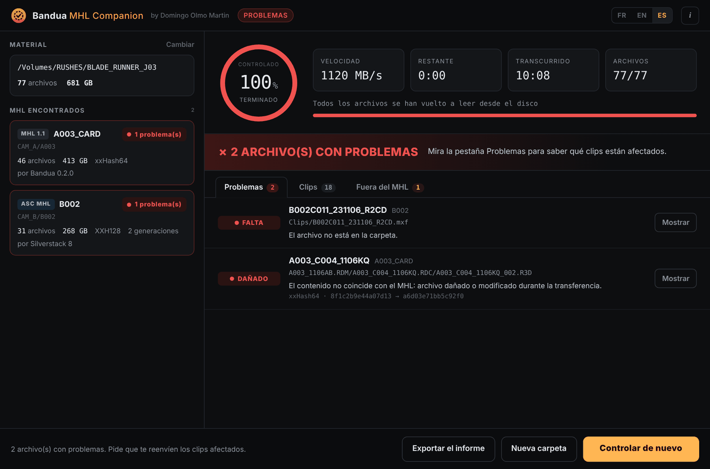

<p align="center">
  
</p>

<h1 align="center">Bandua MHL Companion</h1>
<p align="center"><b>por Domingo Olmo Martin</b></p>
<p align="center">
  <a href="README.md">English</a> · <a href="README.fr.md">Français</a> · <b>Español</b>
</p>

Acabas de recibir material en un disco o por descarga. ¿Se ha dañado algo por el camino? Bandua MHL Companion vuelve a leer cada archivo, lo compara con el MHL que lo acompaña y te dice, clip por clip, qué está intacto y qué no.

Gratuito, para Windows y macOS. Interfaz en español, inglés y francés. Compañera de [Bandua](https://github.com/tetsujin28/bandua), la app de volcado del mismo autor, pero funciona con los MHL escritos por cualquier programa.

<p align="center"></p>

## Descarga

Ve a la **[página de Releases](https://github.com/tetsujin28/bandua-mhl-companion/releases)** y elige el archivo para tu ordenador:

| Sistema | Archivo |
|---|---|
| Windows (sin instalación) | `Bandua_MHL_Companion_x.y.z_portable.exe` |
| Windows (instalador) | `Bandua.MHL.Companion_x.y.z_x64-setup.exe` o `.msi` |
| macOS (Intel y Apple Silicon) | `Bandua.MHL.Companion_x.y.z_universal.dmg` |

**Primer arranque.** La app aún no está firmada, así que tu sistema mostrará un aviso una sola vez:
- **Windows**: haz clic en «Más información» y luego en «Ejecutar de todas formas».
- **macOS**: clic derecho en la app, «Abrir», y confirma.

## Uso

1. **Suelta la carpeta del material** en la ventana (o elígela, o elige un solo archivo `.mhl`). La app encuentra todos los MHL que contiene, aunque estén repartidos en varios días, cámaras y tarjetas.
2. Haz clic en **Iniciar el control**. Cada archivo se vuelve a leer desde el disco, sin pasar por la caché del sistema, y su hash se compara con el MHL.
3. Lee el resultado. La pestaña **Problemas** muestra cada archivo dañado con el nombre de su clip, el tipo de problema y un botón **Mostrar** que lo abre en el Finder o el Explorador. **Clips** muestra cada clip con su estado, **Fuera del MHL** los archivos que no se han podido controlar.
4. **Exporta el informe** (archivo de texto) para enviarlo a producción o al DIT.

| Estado | Significado |
|---|---|
| INTACTO | Idéntico al MHL |
| DAÑADO | Mismo tamaño, contenido diferente: archivo dañado o modificado |
| FALTA | Aparece en el MHL, no está en la carpeta |
| INCOMPLETO | Tamaño diferente del MHL (a menudo una copia interrumpida) |
| ILEGIBLE | El disco no ha podido leer el archivo |
| SIN HASH | El MHL no da ningún hash: solo se ha comprobado el tamaño |

La app es **de solo lectura**: nunca modifica, renombra ni añade nada junto a tu material.

El **[manual de uso completo](docs/GUIDE.es.md)** describe cada pantalla, cada estado y el informe, con capturas comentadas.

## Formatos reconocidos

- **MHL 1.1** (archivo `.mhl`): Bandua, Silverstack, ShotPut Pro, Hedge, YoYotta, mhl-tool…
- **ASC MHL** (carpeta `ascmhl`): se combinan todas las generaciones, y el archivo `ascmhl_chain.xml` sirve para detectar un historial modificado a posteriori.
- Hash: xxHash64, XXH3, XXH128, xxHash32, MD5, SHA-1, SHA-256, C4. Si hay varios, se usa el más rápido.

Los clips se reconocen para RED (carpetas `.RDC`), ARRI (MXF y secuencias ARRIRAW), Blackmagic (BRAW), Sony, Canon, GoPro, DJI y archivos de vídeo genéricos.

## Línea de comandos

Se incluye una pequeña herramienta de línea de comandos para scripts:

```
bandua-mhl-check <carpeta|archivo.mhl> [--lang es|en|fr] [--report informe.txt]
```

Código de salida: `0` todo intacto, `1` problemas encontrados, `2` ningún MHL encontrado.

## Compilar desde el código

Requiere [Rust](https://rustup.rs) y los [requisitos de Tauri 2](https://tauri.app/start/prerequisites/).

```
cargo test -p companion-core
cargo install tauri-cli --version "^2" --locked
cd src-tauri && cargo tauri build
```

## Licencia y aviso

Licencia MIT, © 2026 Domingo Olmo Martin. Ver [LICENSE](LICENSE).

Esta herramienta ayuda a controlar medios; no sustituye tus propios controles ni tus procedimientos de copia de seguridad. Se proporciona «tal cual», sin ninguna garantía. Un control solo es válido si el MHL viene de quien hizo la copia original.
