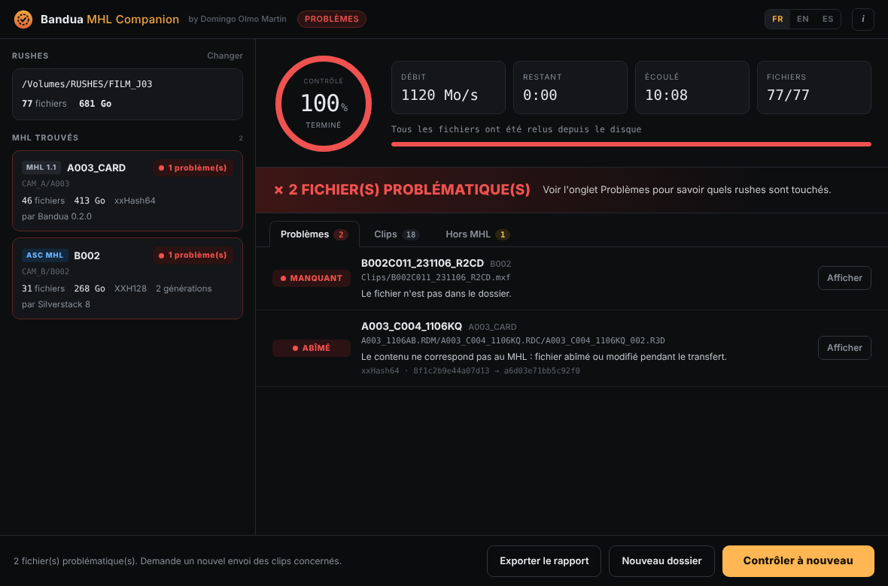

<p align="center">
  
</p>

<h1 align="center">Bandua MHL Companion</h1>
<p align="center"><b>par Domingo Olmo Martin</b></p>
<p align="center">
  <a href="README.md">English</a> · <b>Français</b> · <a href="README.es.md">Español</a>
</p>

Tu viens de recevoir des rushes sur un disque ou par téléchargement. Quelque chose s'est-il abîmé en route ? Bandua MHL Companion relit chaque fichier, le compare au MHL qui l'accompagne et te dit, clip par clip, ce qui est intact et ce qui ne l'est pas.

Gratuit, pour Windows et macOS. Interface en français, anglais et espagnol. Compagnon de [Bandua](https://github.com/tetsujin28/bandua), l'app de déchargement du même auteur, mais il fonctionne avec les MHL écrits par n'importe quel logiciel.

<p align="center"></p>

## Téléchargement

Va sur la **[page des Releases](https://github.com/tetsujin28/bandua-mhl-companion/releases)** et choisis le fichier pour ton ordinateur :

| Système | Fichier |
|---|---|
| Windows (sans installation) | `Bandua_MHL_Companion_x.y.z_portable.exe` |
| Windows (installeur) | `Bandua MHL Companion_x.y.z_x64-setup.exe` ou `.msi` |
| macOS (Intel et Apple Silicon) | `Bandua MHL Companion_x.y.z_universal.dmg` |

**Premier lancement.** L'app n'est pas encore signée, ton système affichera un avertissement une seule fois :
- **Windows** : clique sur « Informations complémentaires », puis « Exécuter quand même ».
- **macOS** : clic droit sur l'app, « Ouvrir », puis confirme.

## Utilisation

1. **Dépose le dossier des rushes** sur la fenêtre (ou choisis-le, ou choisis un seul fichier `.mhl`). L'app trouve tous les MHL qu'il contient, même répartis sur plusieurs jours, caméras et cartes.
2. Clique sur **Lancer le contrôle**. Chaque fichier est relu depuis le disque, sans passer par le cache du système, et son hash est comparé au MHL.
3. Lis le verdict. L'onglet **Problèmes** liste chaque fichier abîmé avec le nom de son clip, la nature du problème et un bouton **Afficher** qui l'ouvre dans le Finder ou l'Explorateur. **Clips** montre chaque clip avec son statut, **Hors MHL** les fichiers qui n'ont pas pu être contrôlés.
4. **Exporte le rapport** (fichier texte) pour le renvoyer à la production ou au DIT.

| Statut | Signification |
|---|---|
| INTACT | Identique au MHL |
| ABÎMÉ | Même taille, contenu différent : fichier abîmé ou modifié |
| MANQUANT | Listé dans le MHL, absent du dossier |
| INCOMPLET | Taille différente du MHL (souvent une copie interrompue) |
| ILLISIBLE | Le disque n'a pas pu lire le fichier |
| SANS HASH | Le MHL ne donne pas de hash : seule la taille a été vérifiée |

L'app est **en lecture seule** : elle ne modifie, ne renomme et n'ajoute jamais rien à côté de tes rushes.

## Formats reconnus

- **MHL 1.1** (fichier `.mhl`) : Bandua, Silverstack, ShotPut Pro, Hedge, YoYotta, mhl-tool…
- **ASC MHL** (dossier `ascmhl`) : toutes les générations sont fusionnées, et le fichier `ascmhl_chain.xml` sert à repérer un historique modifié après coup.
- Hash : xxHash64, XXH3, XXH128, xxHash32, MD5, SHA-1, SHA-256, C4. S'il y en a plusieurs, le plus rapide est utilisé.

Les clips sont reconnus pour RED (dossiers `.RDC`), ARRI (MXF et séquences ARRIRAW), Blackmagic (BRAW), Sony, Canon, GoPro, DJI et les fichiers vidéo génériques.

## Ligne de commande

Un petit outil en ligne de commande est fourni pour les scripts :

```
bandua-mhl-check <dossier|fichier.mhl> [--lang fr|en|es] [--report rapport.txt]
```

Code de sortie : `0` tout est intact, `1` problèmes trouvés, `2` aucun MHL trouvé.

## Compiler soi-même

Nécessite [Rust](https://rustup.rs) et les [prérequis de Tauri 2](https://tauri.app/start/prerequisites/).

```
cargo test -p companion-core
cargo install tauri-cli --version "^2" --locked
cd src-tauri && cargo tauri build
```

## Licence et avertissement

Licence MIT, © 2026 Domingo Olmo Martin. Voir [LICENSE](LICENSE).

Cet outil aide à contrôler des médias ; il ne remplace pas tes propres vérifications ni tes procédures de sauvegarde. Il est fourni « en l'état », sans aucune garantie. Un contrôle n'est valable que si le MHL vient de la personne qui a fait la copie d'origine.
