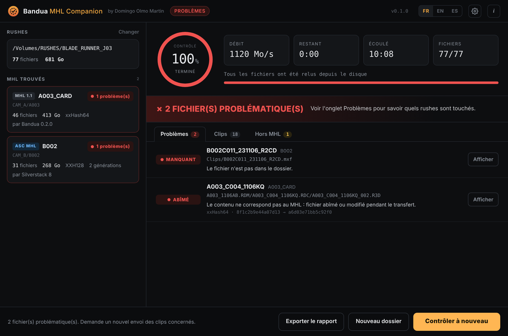

<p align="center">
  
</p>

<h1 align="center">Bandua MHL Companion</h1>
<p align="center"><b>par Domingo Olmo Martin</b></p>
<p align="center">
  <a href="README.md">English</a> · <b>Français</b> · <a href="README.es.md">Español</a>
</p>

Vous venez de recevoir des rushes sur un disque ou par téléchargement. Quelque chose s'est-il abîmé en route ? Bandua MHL Companion relit chaque fichier, le compare au MHL qui l'accompagne et vous dit, clip par clip, ce qui est intact et ce qui ne l'est pas.

Gratuit, pour Windows et macOS. Interface en français, anglais et espagnol. Compagnon de [Bandua](https://github.com/tetsujin28/bandua), l'app de déchargement du même auteur, mais il fonctionne avec les MHL écrits par n'importe quel logiciel.

<p align="center"></p>

## Téléchargement

Allez sur la **[page des Releases](https://github.com/tetsujin28/bandua-mhl-companion/releases)** et choisissez le fichier pour votre ordinateur :

| Système | Fichier |
|---|---|
| Windows (sans installation) | `Bandua_MHL_Companion_x.y.z_portable.exe` |
| Windows (installeur) | `Bandua.MHL.Companion_x.y.z_x64-setup.exe` ou `.msi` |
| macOS (Intel et Apple Silicon) | `Bandua.MHL.Companion_x.y.z_universal.dmg` |

**Premier lancement.** L'app n'est pas encore signée, votre système affichera un avertissement une seule fois :
- **Windows** : cliquez sur « Informations complémentaires », puis « Exécuter quand même ».
- **macOS** : double-cliquez sur l'application, puis fermez le message de blocage. Ouvrez Réglages Système > Confidentialité et sécurité, descendez jusqu'à la section Sécurité et cliquez sur « Ouvrir quand même » à côté du nom de l'application ; confirmez avec le mot de passe de session (demandé une seule fois). Si le bouton n'apparaît pas, ouvrez le Terminal et tapez `xattr -dr com.apple.quarantine ` suivi de l'application glissée dans la fenêtre.

**Nouvelles versions.** Au lancement, l'application demande une fois à GitHub si une version plus récente existe et, si c'est le cas, l'indique en haut à droite ; un clic ouvre la page de téléchargement. Rien ne s'installe tout seul et aucune autre donnée n'est envoyée. Vous pouvez désactiver cette vérification dans les Réglages (la roue dentée).

## Utilisation

1. **Déposez le dossier des rushes** sur la fenêtre (ou choisissez-le, ou choisissez un seul fichier `.mhl`). L'app trouve tous les MHL qu'il contient, même répartis sur plusieurs jours, caméras et cartes.
2. Cliquez sur **Lancer le contrôle**. Chaque fichier est relu depuis le disque, sans passer par le cache du système, et son hash est comparé au MHL.
3. Lisez le verdict. L'onglet **Problèmes** liste chaque fichier abîmé avec le nom de son clip, la nature du problème et un bouton **Afficher** qui l'ouvre dans le Finder ou l'Explorateur. **Clips** montre chaque clip avec son statut, **Hors MHL** les fichiers qui n'ont pas pu être contrôlés.
4. **Exportez le rapport** (fichier texte) pour le renvoyer à la production ou au DIT.

| Statut | Signification |
|---|---|
| INTACT | Identique au MHL |
| ABÎMÉ | Même taille, contenu différent : fichier abîmé ou modifié |
| MANQUANT | Listé dans le MHL, absent du dossier |
| INCOMPLET | Taille différente du MHL (souvent une copie interrompue) |
| ILLISIBLE | Le disque n'a pas pu lire le fichier |
| SANS HASH | Le MHL ne donne pas de hash : seule la taille a été vérifiée |

L'app est **en lecture seule** : elle ne modifie, ne renomme et n'ajoute jamais rien à côté de vos rushes.

Le **[mode d'emploi détaillé](docs/GUIDE.fr.md)** décrit chaque écran, chaque statut et le rapport, avec des captures annotées.

## Formats reconnus

- **MHL 1.1** (fichier `.mhl`) : Bandua, Silverstack, ShotPut Pro, Hedge, YoYotta, mhl-tool…
- **ASC MHL** (dossier `ascmhl`) : toutes les générations sont fusionnées, et le fichier `ascmhl_chain.xml` sert à repérer un historique modifié après coup.
- Hash : xxHash64, XXH3, XXH128, xxHash32, MD5, SHA-1, SHA-256, C4. S'il y en a plusieurs, le plus rapide est utilisé.

Les clips sont reconnus pour RED (dossiers `.RDC`), ARRI (MXF et séquences ARRIRAW), Blackmagic (BRAW), Sony, Canon, GoPro, DJI et les fichiers vidéo génériques.

## Compiler soi-même

Nécessite [Rust](https://rustup.rs) et les [prérequis de Tauri 2](https://tauri.app/start/prerequisites/).

```
cargo test -p companion-core
cargo install tauri-cli --version "^2" --locked
cd src-tauri && cargo tauri build
```

## Apps sœurs

- [Bandua](https://github.com/tetsujin28/bandua) : décharger les cartes caméra et vérifier chaque copie.
- [Lugus Transfer](https://github.com/tetsujin28/lugus-transfer) : envoyer les rushes d'un ordinateur à l'autre avec un lien et un code, vérifiés à l'arrivée.
- [Ataecina](https://github.com/tetsujin28/ataecina) : récupérer et réparer les rushes perdus.

## Licence et avertissement

Licence MIT, © 2026 Domingo Olmo Martin. Voir [LICENSE](LICENSE).

Cet outil aide à contrôler des médias ; il ne remplace pas vos propres vérifications ni vos procédures de sauvegarde. Il est fourni « en l'état », sans aucune garantie. Un contrôle n'est valable que si le MHL vient de la personne qui a fait la copie d'origine.
