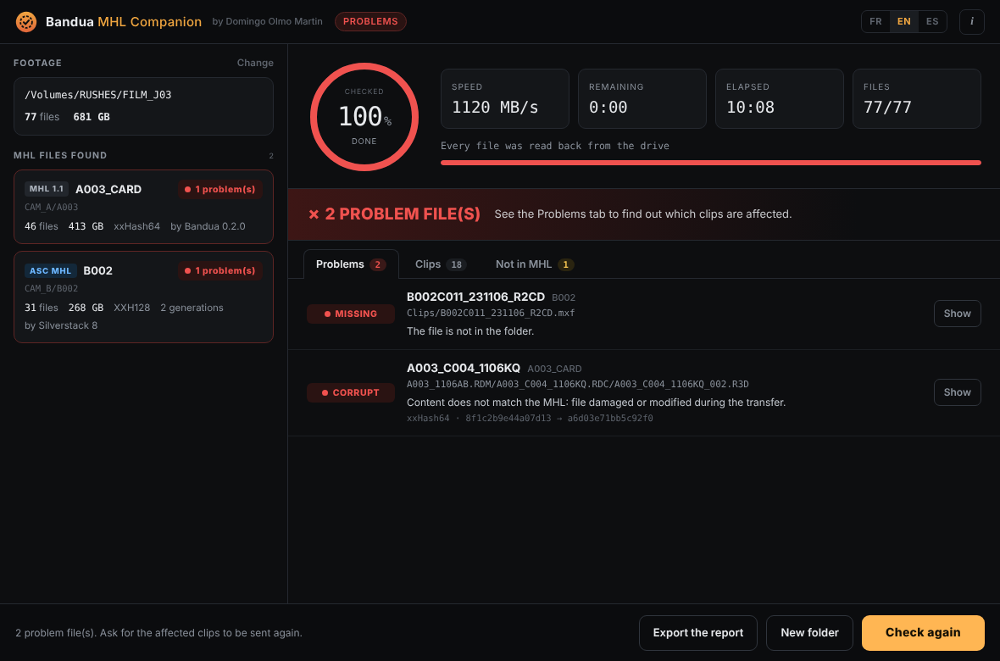

<p align="center">
  
</p>

<h1 align="center">Bandua MHL Companion</h1>
<p align="center"><b>by Domingo Olmo Martin</b></p>
<p align="center">
  <b>English</b> · <a href="README.fr.md">Français</a> · <a href="README.es.md">Español</a>
</p>

You just received footage on a drive or through a download. Was anything damaged on the way? Bandua MHL Companion reads every file back, compares it to the MHL that came with it, and tells you, clip by clip, what is intact and what is not.

Free, for Windows and macOS. Interface in English, French and Spanish. Companion to [Bandua](https://github.com/tetsujin28/bandua), the offload app by the same author, but it works with MHL files written by any tool.

<p align="center"></p>

## Download

Go to the **[Releases page](https://github.com/tetsujin28/bandua-mhl-companion/releases)** and pick the file for your computer:

| System | File |
|---|---|
| Windows (no install) | `Bandua_MHL_Companion_x.y.z_portable.exe` |
| Windows (installer) | `Bandua MHL Companion_x.y.z_x64-setup.exe` or `.msi` |
| macOS (Intel and Apple Silicon) | `Bandua MHL Companion_x.y.z_universal.dmg` |

**First launch.** The app is not signed yet, so your system will warn you once:
- **Windows**: click "More info", then "Run anyway".
- **macOS**: right-click the app, choose "Open", then confirm.

## How to use it

1. **Drop the footage folder** onto the window (or choose it, or pick a single `.mhl` file). The app finds every MHL inside, even across several days, cameras and cards.
2. Click **Start the check**. Every file is read back from the drive, bypassing the system cache, and its hash is compared to the MHL.
3. Read the verdict. The **Problems** tab lists each damaged file with its clip name, what went wrong and a **Show** button that opens it in Finder or Explorer. **Clips** shows every clip with its status, **Not in MHL** lists files that could not be checked.
4. **Export the report** (text file) to send back to the production or the DIT.

| Status | Meaning |
|---|---|
| INTACT | Identical to the MHL |
| CORRUPT | Same size, different content: damaged or modified |
| MISSING | Listed in the MHL, not in the folder |
| INCOMPLETE | Size differs from the MHL (often an interrupted copy) |
| UNREADABLE | The drive could not read the file |
| NO HASH | The MHL gives no hash: only the size was checked |

The app is **read only**: it never changes, renames or adds anything next to your footage.

## Supported formats

- **MHL 1.1** (`.mhl` file): Bandua, Silverstack, ShotPut Pro, Hedge, YoYotta, mhl-tool…
- **ASC MHL** (`ascmhl` folder): all generations are merged, and the `ascmhl_chain.xml` file is used to detect a history that was modified after the fact.
- Hashes: xxHash64, XXH3, XXH128, xxHash32, MD5, SHA-1, SHA-256, C4. When several are given, the fastest one is used.

Clips are recognised for RED (`.RDC` folders), ARRI (MXF and ARRIRAW sequences), Blackmagic (BRAW), Sony, Canon, GoPro, DJI and generic video files.

## Command line

A small command line tool is included for scripts:

```
bandua-mhl-check <folder|file.mhl> [--lang en|fr|es] [--report report.txt]
```

Exit code: `0` all intact, `1` problems found, `2` no MHL found.

## Build from source

Requires [Rust](https://rustup.rs) and the [Tauri 2 prerequisites](https://tauri.app/start/prerequisites/).

```
cargo test -p companion-core
cargo install tauri-cli --version "^2" --locked
cd src-tauri && cargo tauri build
```

## License and disclaimer

MIT License, © 2026 Domingo Olmo Martin. See [LICENSE](LICENSE).

This tool helps check media; it does not replace your own checks and backup procedures. It is provided "as is", without any warranty. A check is only meaningful if the MHL comes from the person who made the original copy.
