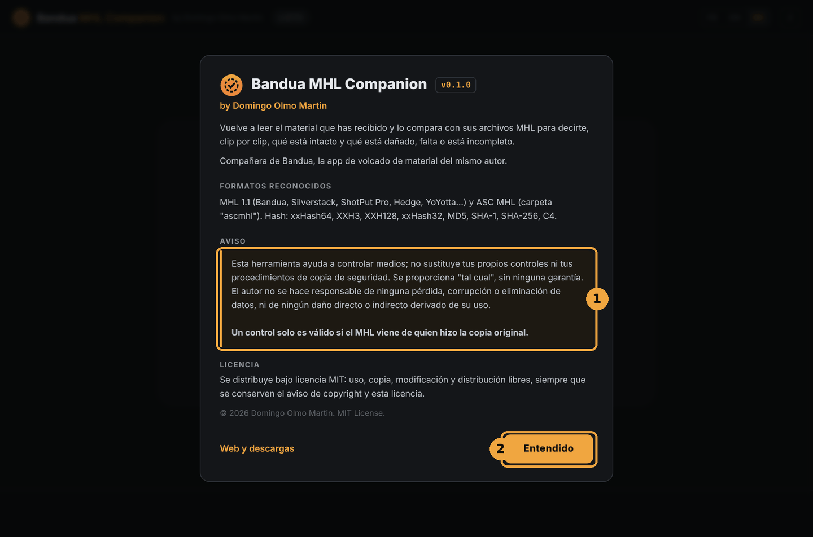
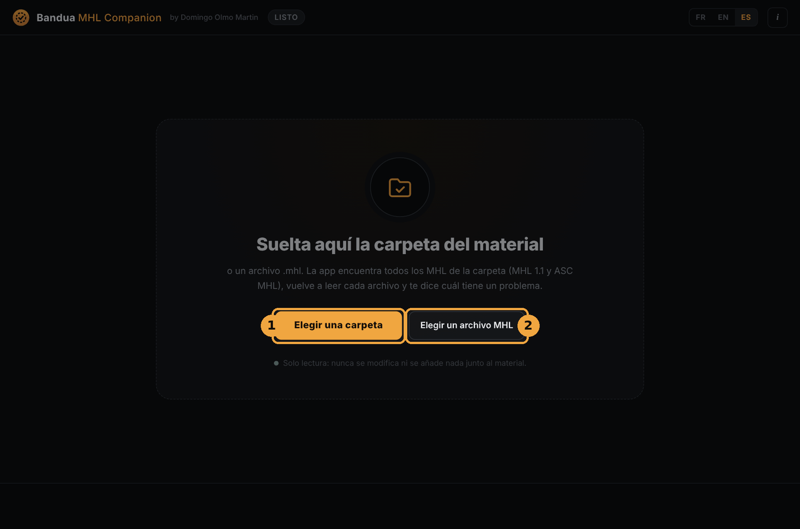
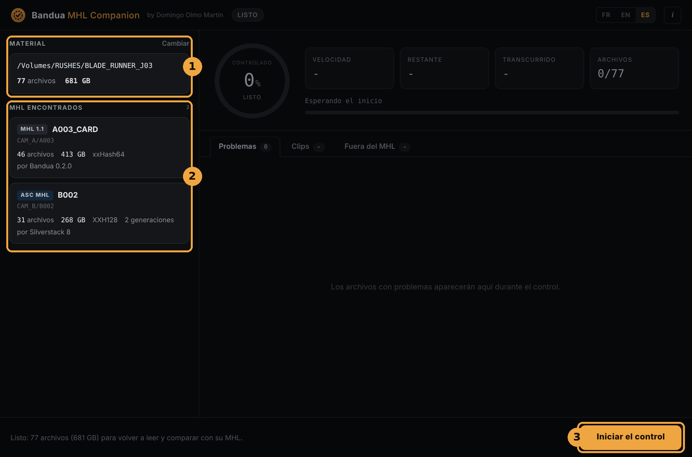
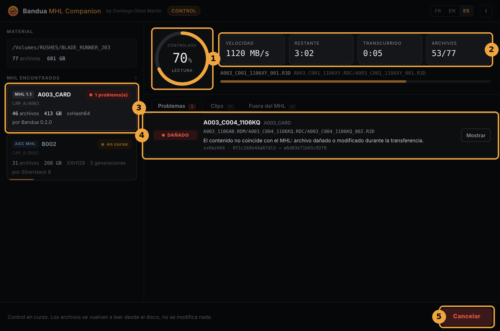
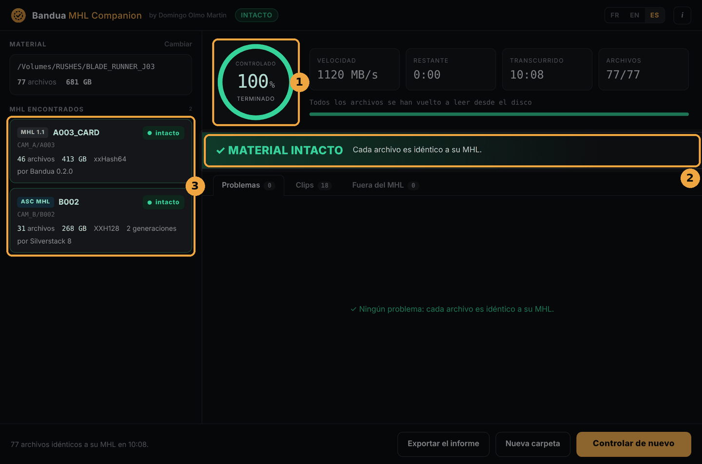
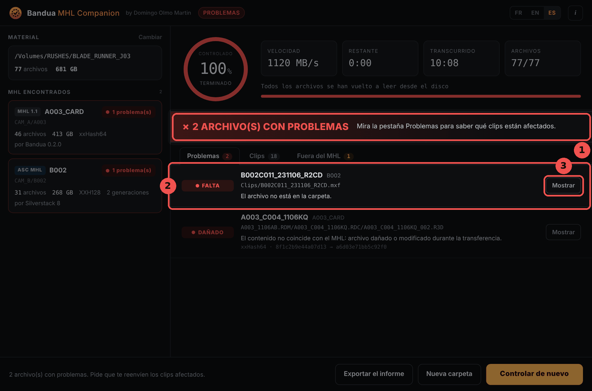
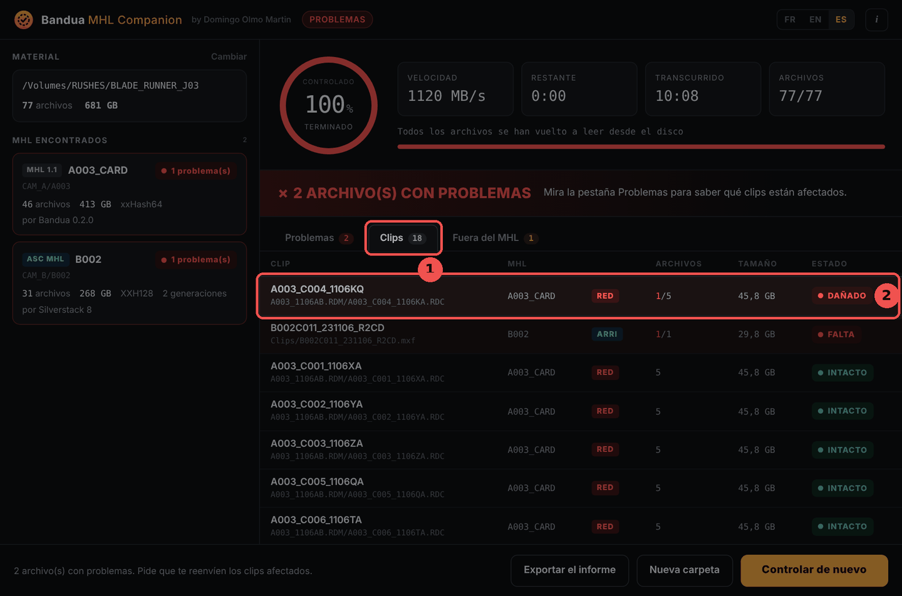
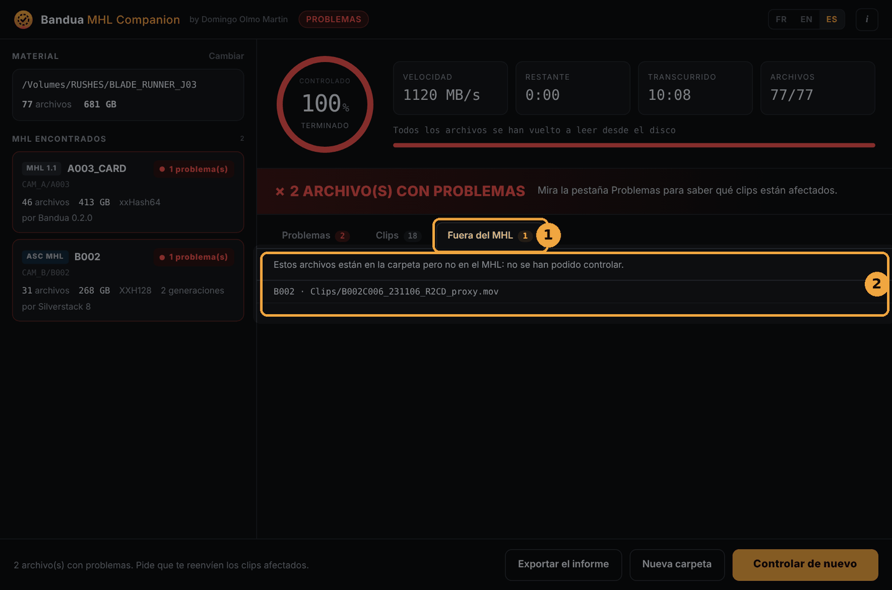
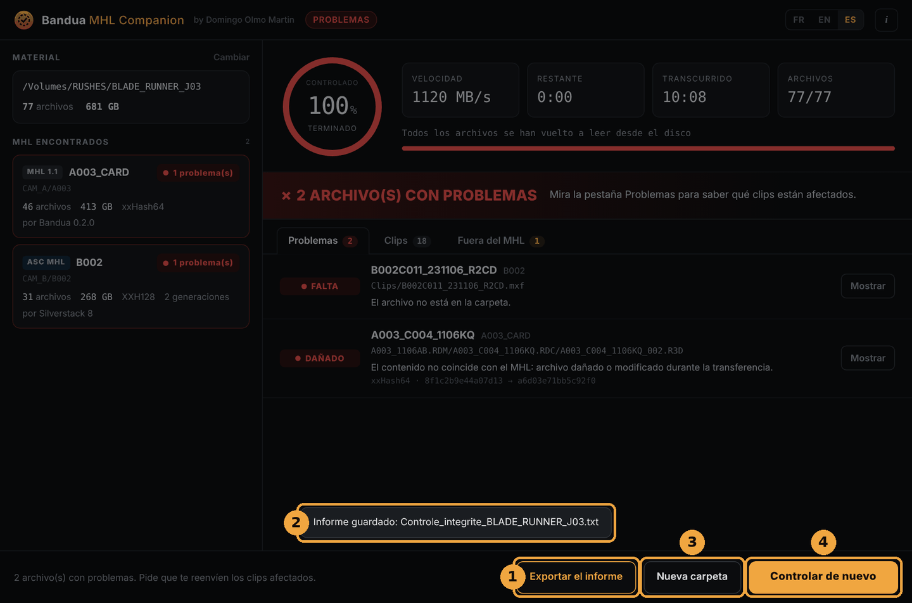

  

<h1 align="center">Bandua MHL Companion, manual de uso</h1>

<b>Versión 0.1.0 · Windows y macOS</b>

  <a href="GUIDE.md">English</a> · <a href="GUIDE.fr.md">Français</a> · <b>Español</b>

## Índice

1. [Presentación](#1-presentación)
2. [Instalación](#2-instalación)
3. [Elegir el material](#3-elegir-el-material)
4. [Iniciar el control](#4-iniciar-el-control)
5. [Leer el resultado](#5-leer-el-resultado)
6. [Exportar el informe](#6-exportar-el-informe)
7. [Los estados en detalle](#7-los-estados-en-detalle)
8. [Formatos reconocidos](#8-formatos-reconocidos)
9. [Buenas prácticas](#9-buenas-prácticas)
10. [Preguntas frecuentes](#10-preguntas-frecuentes)
11. [Aviso y licencia](#11-aviso-y-licencia)

## 1. Presentación

Acabas de recibir material, en un disco o por descarga. ¿Se ha dañado algo por el camino? Bandua MHL Companion vuelve a leer cada archivo, lo compara con el archivo MHL que lo acompaña y te dice, clip por clip, qué está intacto y qué no.

Un **MHL** es la lista de los archivos de una copia, con su tamaño y su huella (hash), escrita por el programa que volcó las tarjetas en el rodaje. Si un archivo cambia, aunque sea un solo byte, su huella cambia: eso es lo que comprueba la app.

La app está pensada para quien **recibe** el material: montador, ayudante de montaje, laboratorio, postproducción, producción, director. Es la compañera de [Bandua](https://github.com/tetsujin28/bandua), la app de volcado del mismo autor, pero también lee los MHL escritos por Silverstack, ShotPut Pro, Hedge y otros.

Funciona **en solo lectura**: nunca modifica, renombra ni añade nada junto a tu material. Gratuita, de código abierto (licencia MIT), sin cuenta.

## 2. Instalación

### Descargar

Ve a la [página de Releases](https://github.com/tetsujin28/bandua-mhl-companion/releases) y elige el archivo para tu ordenador:

| Sistema | Archivo |
|---|---|
| Windows, sin instalación | `Bandua_MHL_Companion_x.y.z_portable.exe` |
| Windows, con instalador | `Bandua.MHL.Companion_x.y.z_x64-setup.exe` o `.msi` |
| macOS (Intel y Apple Silicon) | `Bandua.MHL.Companion_x.y.z_universal.dmg` |

### Primer arranque

La app aún no está firmada, así que tu sistema muestra un aviso, una sola vez:

- **Windows**: haz clic en «Más información» y luego en «Ejecutar de todas formas».
- **macOS**: haz clic derecho en la app, elige «Abrir» y confirma.

### Ventana de bienvenida

En el primer arranque, la app presenta lo que hace, los formatos reconocidos y un aviso (1). Léelo y haz clic en **Entendido** (2). Lo encontrarás en **Acerca de** (el botón *i*, arriba a la derecha). Los botones **FR / EN / ES** cambian el idioma en cualquier momento.

## 3. Elegir el material

Tres formas de empezar:

- **arrastra la carpeta del material** a la ventana y suéltala;
- haz clic en **Elegir una carpeta** (1);
- o haz clic en **Elegir un archivo MHL** (2) para controlar una sola tarjeta.

Puedes darle la carpeta de un día entero, o incluso de todo un rodaje: la app encuentra **todos los MHL** que contiene, de varios días, cámaras y tarjetas a la vez.

Si no encuentra ningún MHL, te lo dice. Pide entonces a quien te envió el material el archivo `.mhl`, o la carpeta `ascmhl`.

## 4. Iniciar el control

1. **Material**: la carpeta elegida, con su número de archivos y su tamaño total. **Cambiar** permite elegir otra.
2. **MHL encontrados**: una ficha por MHL, con su formato (*MHL 1.1* o *ASC MHL*), su nombre, su ubicación en la carpeta, el número de archivos, el tamaño, el algoritmo de hash, el programa que lo escribió y, para un ASC MHL, su número de generaciones.
3. El mensaje de abajo resume el trabajo. Haz clic en **Iniciar el control**.

Durante el control:

1. el **círculo** muestra la parte del material ya releída;
2. los **contadores** dan la velocidad, el tiempo restante, el tiempo transcurrido y el número de archivos leídos;
3. cada **ficha MHL** muestra su estado: *en espera*, *en curso*, *intacto* o su número de problemas;
4. los **problemas** aparecen a medida que se encuentran, sin esperar al final;
5. el botón pasa a **Cancelar**. Haz clic en él y luego en **Confirmar la cancelación** antes de tres segundos. Un control interrumpido da un resultado incompleto.

Cada archivo se relee **desde el disco**, evitando la caché del sistema, así que el control cubre de verdad lo que está escrito en el disco. El tiempo depende sobre todo de la velocidad del disco: cuenta lo que dura una lectura completa del material.

## 5. Leer el resultado

### Todo está bien

1. El círculo pasa a verde, con la palabra *terminado*.
2. La franja **✓ MATERIAL INTACTO** confirma que cada archivo es idéntico a su MHL.
3. Cada ficha MHL indica *intacto*.

### Hay problemas

1. La franja roja indica el número de archivos con problemas.
2. La pestaña **Problemas** lista cada archivo afectado: su estado (*DAÑADO*, *FALTA*…), el nombre del **clip** al que pertenece, el MHL correspondiente, su ruta y una explicación. Para un archivo dañado, se muestran las dos huellas (la esperada y la leída).
3. El botón **Mostrar** abre la carpeta del archivo en el Explorador o en el Finder.

Lo más útil para lo que sigue es el **nombre del clip**: es lo que pedirás que te vuelvan a enviar.

### Las otras pestañas

La pestaña **Clips** (1) muestra todos los clips, con su MHL, su marca (RED, ARRI, Blackmagic, Sony, Canon, GoPro, DJI), su número de archivos, su tamaño y su estado. Los clips con problemas aparecen primero (2). Una carpeta `.RDC` de RED cuenta como un clip, igual que una secuencia ARRIRAW o un `.braw`.

La pestaña **Fuera del MHL** (1) lista los archivos que están en la carpeta pero en ningún MHL (2), por ejemplo proxies añadidos después. **No se han podido controlar**, porque el MHL no dice nada de ellos. No es necesariamente un problema, pero conviene saberlo.

## 6. Exportar el informe

1. **Exportar el informe** guarda un archivo de texto donde tú elijas, por ejemplo `Control_integridad_BLADE_RUNNER_J03_2026-11-10_1432.txt`. Lista los MHL controlados, cada problema con su clip y los archivos fuera del MHL. Es el archivo que envías a producción o al DIT.
2. Un mensaje confirma que se ha guardado.
3. **Nueva carpeta** vuelve a la pantalla de inicio.
4. **Controlar de nuevo** vuelve a lanzar el control sobre la misma carpeta, por ejemplo después de copiar de nuevo un clip.

El informe es el único archivo que escribe la app, y solo donde tú decidas.

## 7. Los estados en detalle

| Estado | Significado | Qué hacer |
|---|---|---|
| **INTACTO** | El archivo es idéntico al MHL. | Nada. |
| **DAÑADO** | Mismo tamaño, contenido distinto: el archivo se dañó o se modificó durante la transferencia. | Volver a pedir el clip. |
| **FALTA** | El archivo figura en el MHL pero no está en la carpeta. | Revisar la copia, volver a pedir el clip. |
| **INCOMPLETO** | Tamaño distinto del del MHL, a menudo una copia interrumpida. | Volver a copiar el archivo y controlar de nuevo. |
| **ILEGIBLE** | El disco no ha podido leer el archivo. | Revisar el disco y el cable, probar en otro ordenador. |
| **SIN HASH** | El MHL no da huella para este archivo: solo se ha comprobado su tamaño. | Pedir un MHL completo si es importante. |

Si un historial **ASC MHL** se modificó después de crearse, la ficha del MHL lo indica: «Historial ASC MHL modificado después de crearse». Desconfía de ese MHL y pide uno nuevo.

## 8. Formatos reconocidos

- **MHL 1.1** (archivo `.mhl`): Bandua, Silverstack, ShotPut Pro, Hedge, YoYotta, mhl-tool…
- **ASC MHL** (carpeta `ascmhl`): se combinan todas las generaciones, y el archivo `ascmhl_chain.xml` sirve para detectar un historial modificado a posteriori.
- **Hash**: xxHash64, XXH3, XXH128, xxHash32, MD5, SHA-1, SHA-256, C4. Si un MHL da varios, se usa el más rápido.
- **Clips** reconocidos: RED (carpetas `.RDC`), ARRI (MXF y secuencias ARRIRAW), Blackmagic (BRAW), Sony, Canon, GoPro, DJI, y los archivos de vídeo habituales.

## 9. Buenas prácticas

- **Controla al recibir**, antes de empezar a trabajar y antes de que el equipo de rodaje formatee las tarjetas.
- **Conserva el disco original** hasta que termine el control y tengas tus propias copias.
- **Un MHL solo vale si viene de quien hizo la copia original**, idealmente enviado aparte del material (por correo, por ejemplo). Un MHL hecho después sobre archivos ya dañados los daría por intactos.
- **Controla también tus propias copias**: después de copiar el material en tu disco de montaje, vuelve a lanzar el control sobre la copia.
- **Exporta el informe** y guárdalo con el proyecto.

## 10. Preguntas frecuentes

**¿Hace falta Bandua para usar la app?**
No. Lee los MHL de Bandua, pero también los de otros programas.

**¿La app modifica mis archivos?**
No, nunca. Solo lee. El único archivo que escribe es el informe, cuando lo exportas.

**¿Por qué tarda tanto el control?**
Cada archivo se vuelve a leer entero, desde el disco. El tiempo depende de la velocidad del disco y de la cantidad de material.

**Un archivo está DAÑADO, pero el vídeo se reproduce bien. ¿Es grave?**
Sí, hay que avisar. El archivo ya no es el que se rodó: el error puede estar en una imagen que aún no has visto, o en los metadatos.

**¿Existe una versión de línea de comandos?**
Sí, para scripts: `bandua-mhl-check <carpeta|archivo.mhl> [--lang fr|en|es] [--report informe.txt]`. Código de salida: `0` todo está intacto, `1` se han encontrado problemas, `2` no hay ningún MHL.

**¿La app envía datos por Internet?**
No. Todo ocurre en tu ordenador.

## 11. Aviso y licencia

Esta herramienta ayuda a controlar medios. No sustituye tus propias comprobaciones ni tus procedimientos de copia de seguridad. Se ofrece «tal cual», sin ninguna garantía. El autor no se hace responsable de ninguna pérdida, corrupción o eliminación de datos, ni de ningún daño directo o indirecto derivado de su uso.

**Un control solo es válido si el MHL viene de quien hizo la copia original.**

© 2026 Domingo Olmo Martin. Distribuido bajo [licencia MIT](../LICENSE).
