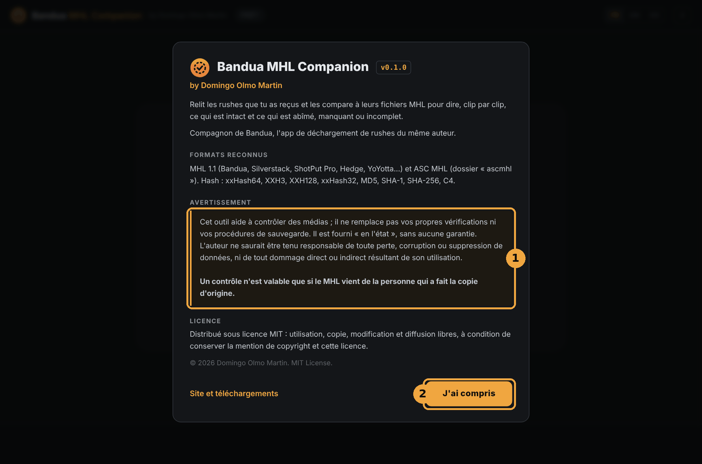
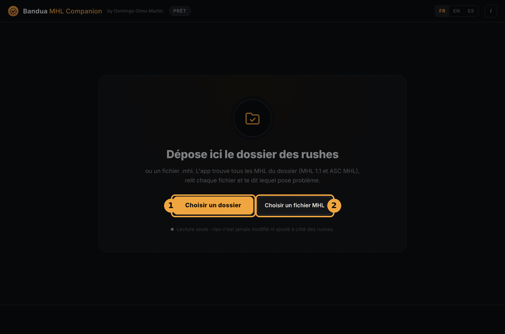
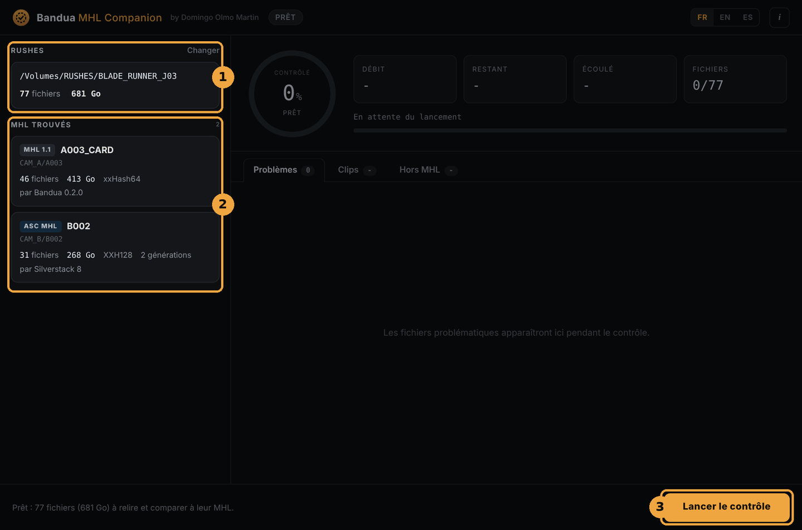
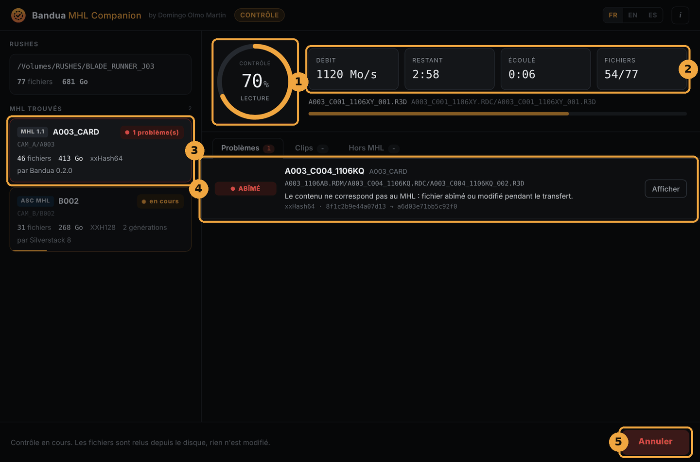
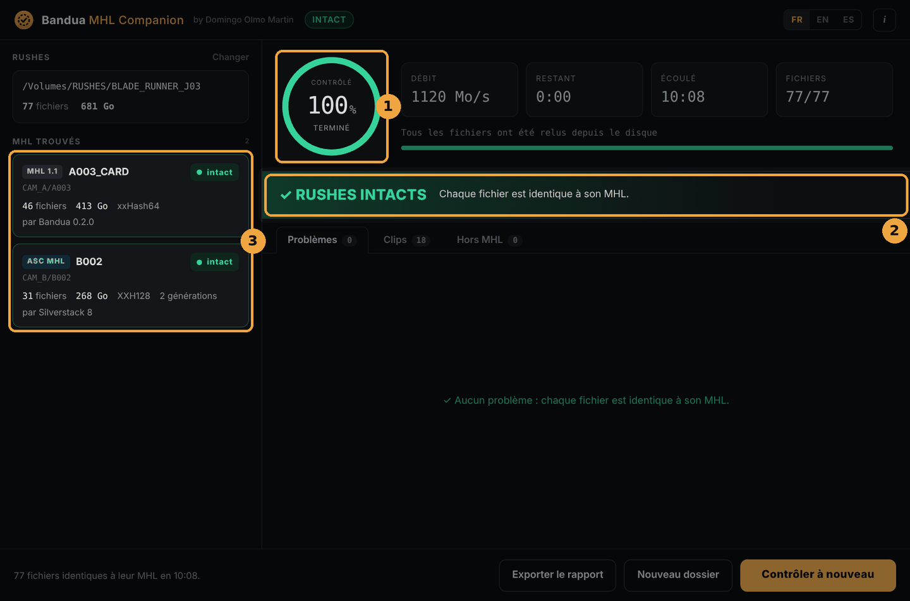
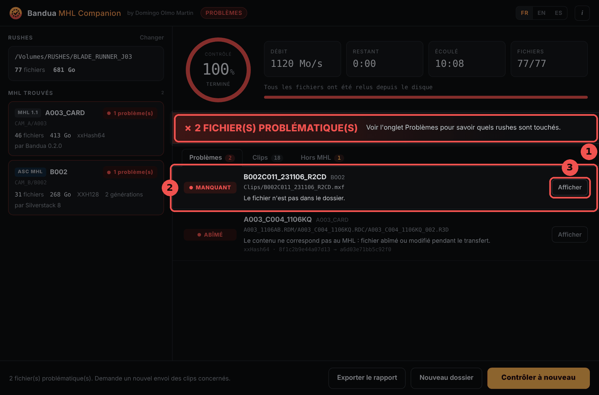
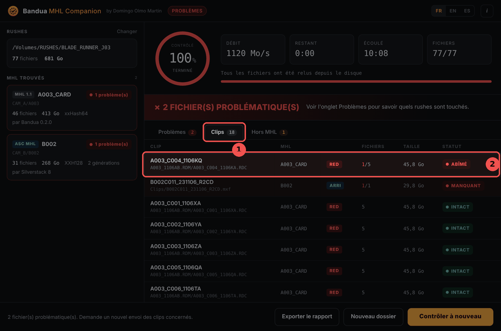
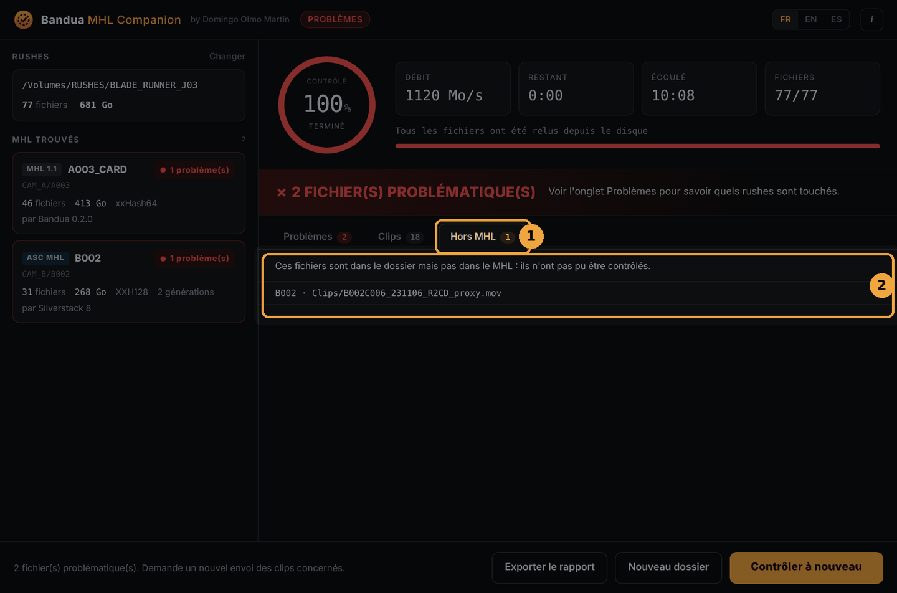
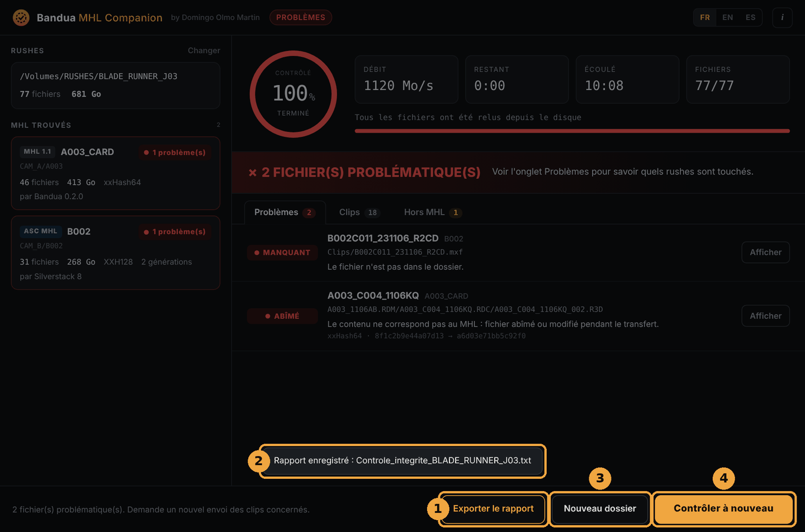

  

<h1 align="center">Bandua MHL Companion, mode d'emploi</h1>

<b>Version 0.1.0 · Windows et macOS</b>

  <a href="GUIDE.md">English</a> · <b>Français</b> · <a href="GUIDE.es.md">Español</a>

## Sommaire

1. [Présentation](#1-présentation)
2. [Installation](#2-installation)
3. [Choisir les rushes](#3-choisir-les-rushes)
4. [Lancer le contrôle](#4-lancer-le-contrôle)
5. [Lire le résultat](#5-lire-le-résultat)
6. [Exporter le rapport](#6-exporter-le-rapport)
7. [Les statuts en détail](#7-les-statuts-en-détail)
8. [Formats reconnus](#8-formats-reconnus)
9. [Bonnes pratiques](#9-bonnes-pratiques)
10. [Questions fréquentes](#10-questions-fréquentes)
11. [Avertissement et licence](#11-avertissement-et-licence)

## 1. Présentation

Tu viens de recevoir des rushes, sur un disque ou par téléchargement. Quelque chose s'est-il abîmé en route ? Bandua MHL Companion relit chaque fichier, le compare au fichier MHL qui l'accompagne et te dit, clip par clip, ce qui est intact et ce qui ne l'est pas.

Un **MHL** est la liste des fichiers d'une copie, avec leur taille et leur empreinte (hash), écrite par le logiciel qui a déchargé les cartes sur le plateau. Si un fichier change, même d'un seul octet, son empreinte change : c'est ce que l'app vérifie.

L'app s'adresse à ceux qui **reçoivent** les rushes : monteur, assistant de montage, labo, post-production, production, réalisateur. Elle est le compagnon de [Bandua](https://github.com/tetsujin28/bandua), l'app de déchargement du même auteur, mais elle lit aussi les MHL écrits par Silverstack, ShotPut Pro, Hedge et les autres.

Elle est **en lecture seule** : elle ne modifie, ne renomme et n'ajoute jamais rien à côté de tes rushes. Gratuite, open source (licence MIT), sans compte.

## 2. Installation

### Télécharger

Va sur la [page des Releases](https://github.com/tetsujin28/bandua-mhl-companion/releases) et choisis le fichier pour ton ordinateur :

| Système | Fichier |
|---|---|
| Windows, sans installation | `Bandua_MHL_Companion_x.y.z_portable.exe` |
| Windows, avec installeur | `Bandua.MHL.Companion_x.y.z_x64-setup.exe` ou `.msi` |
| macOS (Intel et Apple Silicon) | `Bandua.MHL.Companion_x.y.z_universal.dmg` |

### Premier lancement

L'app n'est pas encore signée. Ton système affiche donc un avertissement, une seule fois :

- **Windows** : clique sur « Informations complémentaires », puis sur « Exécuter quand même ».
- **macOS** : fais un clic droit sur l'app, choisis « Ouvrir », puis confirme.

### Fenêtre de bienvenue

Au premier lancement, l'app présente ce qu'elle fait, les formats reconnus et un avertissement (1). Lis-le, puis clique sur **J'ai compris** (2). Tu le retrouveras dans **À propos** (le bouton *i*, en haut à droite). Les boutons **FR / EN / ES** changent la langue à tout moment.

## 3. Choisir les rushes

Trois façons de commencer :

- **Glisse le dossier des rushes** sur la fenêtre et relâche-le ;
- clique sur **Choisir un dossier** (1) ;
- ou clique sur **Choisir un fichier MHL** (2) pour ne contrôler qu'une seule carte.

Tu peux donner le dossier de toute une journée, voire de tout un tournage : l'app cherche **tous les MHL** qu'il contient, sur plusieurs jours, caméras et cartes à la fois.

Si aucun MHL n'est trouvé, l'app te le dit. Demande alors à la personne qui t'a envoyé les rushes le fichier `.mhl`, ou le dossier `ascmhl`.

## 4. Lancer le contrôle

1. **Rushes** : le dossier choisi, avec le nombre de fichiers et la taille totale. **Changer** permet d'en choisir un autre.
2. **MHL trouvés** : une fiche par MHL, avec son format (*MHL 1.1* ou *ASC MHL*), son nom, son emplacement dans le dossier, le nombre de fichiers, la taille, l'algorithme de hash, le logiciel qui l'a écrit et, pour un ASC MHL, son nombre de générations.
3. Le message du bas résume le travail. Clique sur **Lancer le contrôle**.

Pendant le contrôle :

1. le **cercle** montre la part des rushes déjà relue ;
2. les **compteurs** donnent le débit, le temps restant, le temps écoulé et le nombre de fichiers relus ;
3. chaque **fiche MHL** affiche son état : *en attente*, *en cours*, *intact* ou le nombre de problèmes ;
4. les **problèmes** s'affichent au fur et à mesure, sans attendre la fin ;
5. le bouton devient **Annuler**. Clique dessus, puis sur **Confirmer l'annulation** dans les trois secondes. Un contrôle interrompu donne un résultat incomplet.

Chaque fichier est relu **depuis le disque**, en contournant le cache du système. Le contrôle porte donc vraiment sur ce qui est écrit sur le disque. Le temps dépend surtout de la vitesse du disque : compte la durée d'une lecture complète des rushes.

## 5. Lire le résultat

### Tout est bon

1. Le cercle passe au vert, avec la mention *terminé*.
2. Le bandeau **✓ RUSHES INTACTS** confirme que chaque fichier est identique à son MHL.
3. Chaque fiche MHL indique *intact*.

### Il y a des problèmes

1. Le bandeau rouge indique le nombre de fichiers problématiques.
2. L'onglet **Problèmes** liste chaque fichier en cause : son statut (*ABÎMÉ*, *MANQUANT*…), le nom du **clip** auquel il appartient, le MHL concerné, son chemin et une explication. Pour un fichier abîmé, les deux empreintes (attendue et lue) sont affichées.
3. Le bouton **Afficher** ouvre le dossier du fichier dans l'Explorateur ou le Finder.

Le plus utile pour la suite : le **nom du clip**. C'est lui que tu demanderas à renvoyer.

### Les autres onglets

L'onglet **Clips** (1) montre tous les clips, avec leur MHL, leur marque (RED, ARRI, Blackmagic, Sony, Canon, GoPro, DJI), leur nombre de fichiers, leur taille et leur statut. Les clips en cause sont en tête de liste (2). Un dossier `.RDC` RED compte pour un clip, tout comme une séquence ARRIRAW ou un `.braw`.

L'onglet **Hors MHL** (1) liste les fichiers présents dans le dossier mais absents de tout MHL (2), par exemple des proxys ajoutés après coup. Ils n'ont **pas pu être contrôlés**, puisque le MHL ne dit rien d'eux. Ce n'est pas forcément un problème, mais il vaut mieux le savoir.

## 6. Exporter le rapport

1. **Exporter le rapport** enregistre un fichier texte à l'endroit de ton choix, par exemple `Controle_integrite_BLADE_RUNNER_J03_2026-11-10_1432.txt`. Il liste les MHL contrôlés, chaque problème avec son clip, et les fichiers hors MHL. C'est ce fichier que tu renvoies à la production ou au DIT.
2. Un message confirme l'enregistrement.
3. **Nouveau dossier** revient à l'écran d'accueil.
4. **Contrôler à nouveau** relance le contrôle sur le même dossier, par exemple après avoir recopié un clip.

Le rapport est le seul fichier que l'app écrit, et seulement là où tu le décides.

## 7. Les statuts en détail

| Statut | Signification | Que faire |
|---|---|---|
| **INTACT** | Le fichier est identique au MHL. | Rien. |
| **ABÎMÉ** | Même taille, contenu différent : le fichier a été abîmé ou modifié pendant le transfert. | Redemander le clip. |
| **MANQUANT** | Le fichier est listé dans le MHL mais absent du dossier. | Vérifier la copie, redemander le clip. |
| **INCOMPLET** | Taille différente de celle du MHL, souvent une copie interrompue. | Recopier le fichier, puis contrôler à nouveau. |
| **ILLISIBLE** | Le disque n'a pas pu lire le fichier. | Vérifier le disque et le câble, essayer sur un autre ordinateur. |
| **SANS HASH** | Le MHL ne donne pas d'empreinte pour ce fichier : seule sa taille a été vérifiée. | Demander un MHL complet si c'est important. |

Si un historique **ASC MHL** a été modifié après sa création, la fiche du MHL l'indique : « Historique ASC MHL modifié après sa création ». Méfie-toi alors de ce MHL et demande-en un nouveau.

## 8. Formats reconnus

- **MHL 1.1** (fichier `.mhl`) : Bandua, Silverstack, ShotPut Pro, Hedge, YoYotta, mhl-tool…
- **ASC MHL** (dossier `ascmhl`) : toutes les générations sont fusionnées, et le fichier `ascmhl_chain.xml` sert à repérer un historique modifié après coup.
- **Hash** : xxHash64, XXH3, XXH128, xxHash32, MD5, SHA-1, SHA-256, C4. Si un MHL en donne plusieurs, le plus rapide est utilisé.
- **Clips** reconnus : RED (dossiers `.RDC`), ARRI (MXF et séquences ARRIRAW), Blackmagic (BRAW), Sony, Canon, GoPro, DJI, et les fichiers vidéo courants.

## 9. Bonnes pratiques

- **Contrôle dès réception**, avant de commencer à travailler et avant que l'équipe de tournage ne formate les cartes.
- **Garde le disque d'origine** tant que le contrôle n'est pas terminé et que tes propres copies ne sont pas faites.
- **Un MHL n'a de valeur que s'il vient de la personne qui a fait la copie d'origine**, idéalement envoyé à part des rushes (par e-mail, par exemple). Un MHL refait après coup sur des fichiers déjà abîmés les déclarerait intacts.
- **Contrôle aussi tes propres copies** : après avoir copié les rushes sur ton disque de montage, relance le contrôle sur la copie.
- **Exporte le rapport** et garde-le avec le projet.

## 10. Questions fréquentes

**Faut-il avoir Bandua pour utiliser l'app ?**
Non. Elle lit les MHL de Bandua, mais aussi ceux des autres logiciels.

**L'app modifie-t-elle mes fichiers ?**
Non, jamais. Elle ne fait que lire. Le seul fichier écrit est le rapport, quand tu l'exportes.

**Pourquoi le contrôle est-il aussi long ?**
Chaque fichier est relu en entier, depuis le disque. La durée dépend de la vitesse du disque et de la quantité de rushes.

**Un fichier est ABÎMÉ, mais la vidéo se lit bien. C'est grave ?**
Oui, il faut le signaler. Le fichier n'est plus celui qui a été tourné : l'erreur peut se trouver sur une image que tu n'as pas encore vue, ou dans les métadonnées.

**Existe-t-il une version en ligne de commande ?**
Oui, pour les scripts : `bandua-mhl-check <dossier|fichier.mhl> [--lang fr|en|es] [--report rapport.txt]`. Code de sortie : `0` tout est intact, `1` problèmes trouvés, `2` aucun MHL trouvé.

**L'app envoie-t-elle des données sur Internet ?**
Non. Tout se passe sur ton ordinateur.

## 11. Avertissement et licence

Cet outil aide à contrôler des médias. Il ne remplace pas tes propres vérifications ni tes procédures de sauvegarde. Il est fourni « en l'état », sans aucune garantie. L'auteur ne saurait être tenu responsable de toute perte, corruption ou suppression de données, ni de tout dommage direct ou indirect résultant de son utilisation.

**Un contrôle n'est valable que si le MHL vient de la personne qui a fait la copie d'origine.**

© 2026 Domingo Olmo Martin. Distribué sous [licence MIT](../LICENSE).
