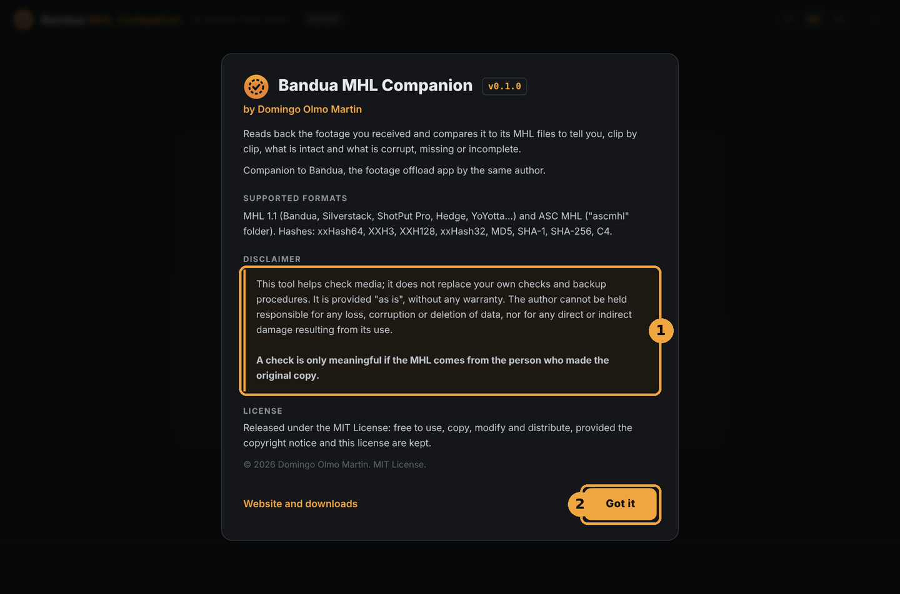
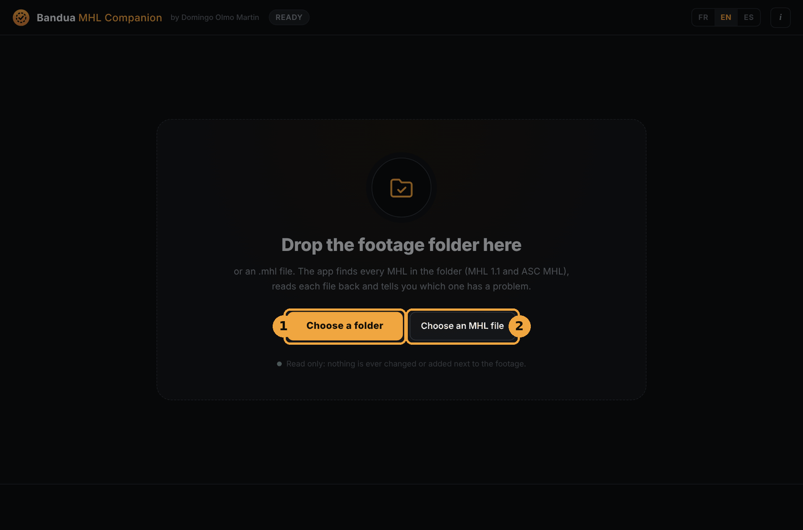
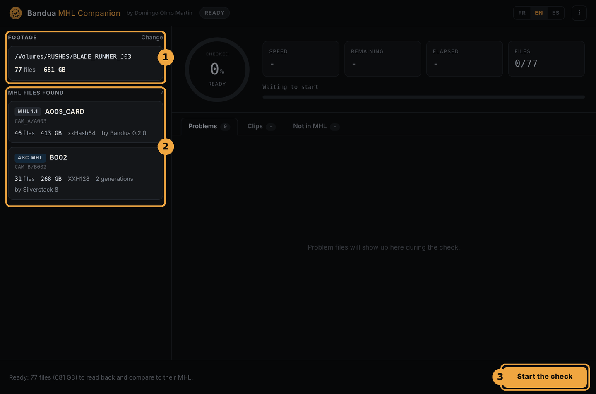
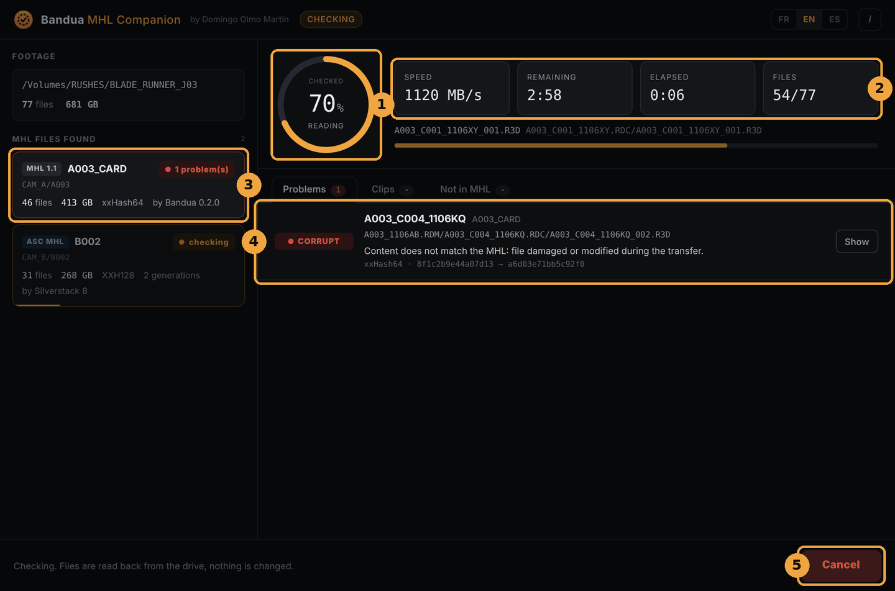
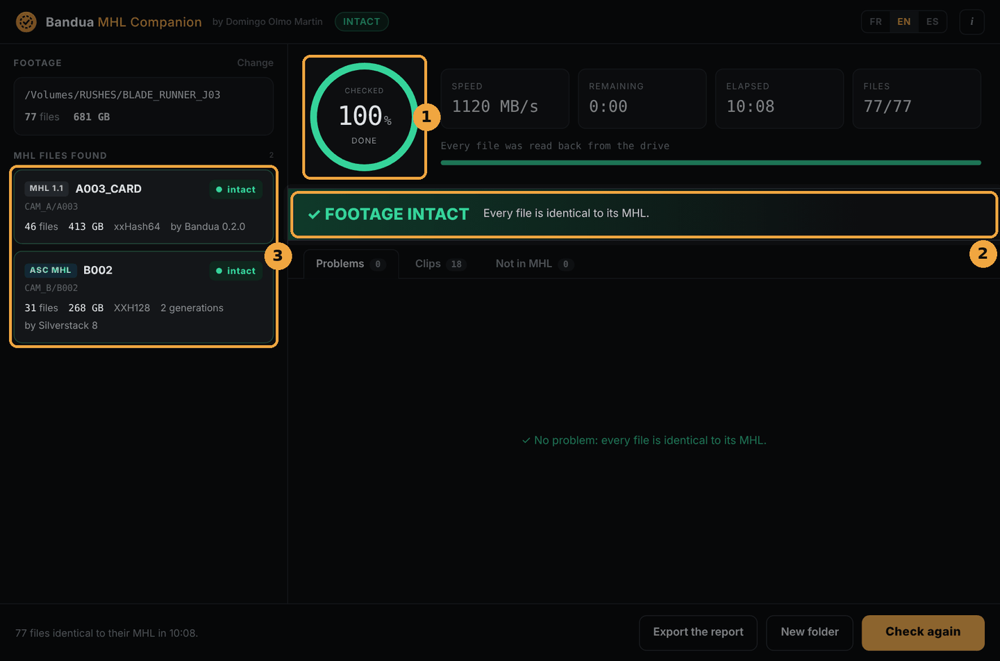
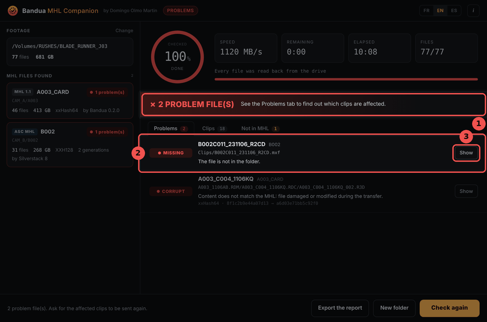
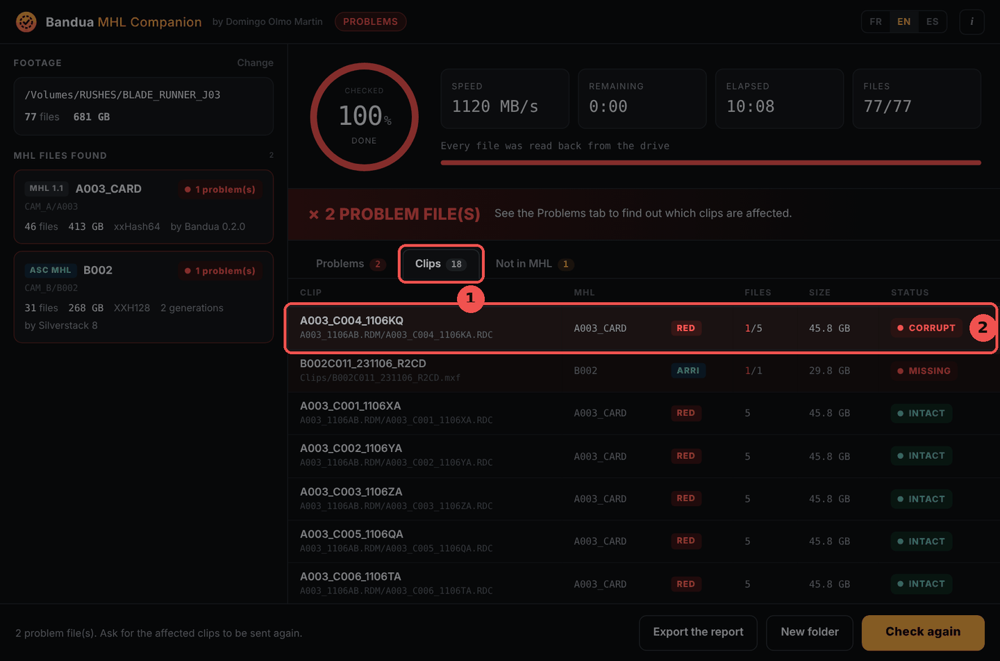
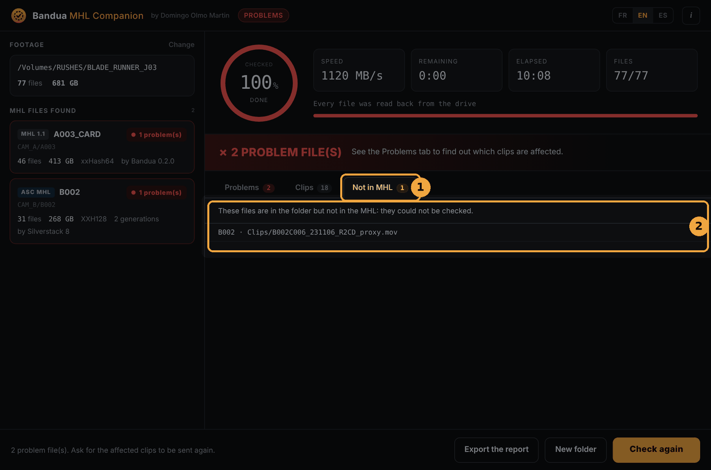
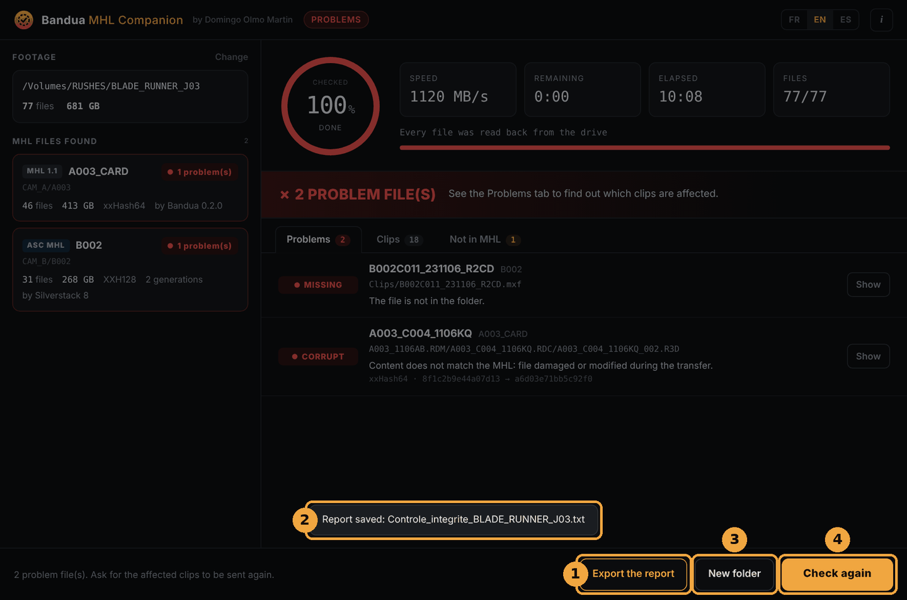

  

<h1 align="center">Bandua MHL Companion user guide</h1>

<b>Version 0.1.0 · Windows and macOS</b>

  <b>English</b> · <a href="GUIDE.fr.md">Français</a> · <a href="GUIDE.es.md">Español</a>

## Contents

1. [Overview](#1-overview)
2. [Installation](#2-installation)
3. [Choosing the footage](#3-choosing-the-footage)
4. [Running the check](#4-running-the-check)
5. [Reading the result](#5-reading-the-result)
6. [Exporting the report](#6-exporting-the-report)
7. [Statuses in detail](#7-statuses-in-detail)
8. [Supported formats](#8-supported-formats)
9. [Good practice](#9-good-practice)
10. [FAQ](#10-faq)
11. [Disclaimer and license](#11-disclaimer-and-license)

## 1. Overview

You have just received footage, on a drive or as a download. Did anything get damaged on the way? Bandua MHL Companion reads every file back, compares it with the MHL file that came with it, and tells you, clip by clip, what is intact and what is not.

An **MHL** is the list of the files in a copy, with their size and fingerprint (hash), written by the software that offloaded the cards on set. If a file changes, even by a single byte, its fingerprint changes: that is what the app checks.

The app is made for the people who **receive** the footage: editor, assistant editor, lab, post-production, production, director. It is the companion of [Bandua](https://github.com/tetsujin28/bandua), the offload app by the same author, but it also reads MHL files written by Silverstack, ShotPut Pro, Hedge and others.

It is **read-only**: it never changes, renames or adds anything next to your footage. Free, open source (MIT License), no account needed.

## 2. Installation

### Download

Go to the [Releases page](https://github.com/tetsujin28/bandua-mhl-companion/releases) and pick the file for your computer:

| System | File |
|---|---|
| Windows, no install | `Bandua_MHL_Companion_x.y.z_portable.exe` |
| Windows, installer | `Bandua.MHL.Companion_x.y.z_x64-setup.exe` or `.msi` |
| macOS (Intel and Apple Silicon) | `Bandua.MHL.Companion_x.y.z_universal.dmg` |

### First launch

The app is not signed yet, so your system shows a warning, only once:

- **Windows**: click "More info", then "Run anyway".
- **macOS**: right-click the app, choose "Open", then confirm.

### Welcome window

On first launch, the app explains what it does, the supported formats and a disclaimer (1). Read it, then click **Got it** (2). You can find it again under **About** (the *i* button, top right). The **FR / EN / ES** buttons switch the language at any time.

## 3. Choosing the footage

Three ways to begin:

- **drag the footage folder** onto the window and drop it;
- click **Choose a folder** (1);
- or click **Choose an MHL file** (2) to check a single card only.

You can give it the folder of a whole day, or even a whole shoot: the app finds **every MHL** inside, across several days, cameras and cards at once.

If no MHL is found, the app says so. Ask the person who sent you the footage for the `.mhl` file, or the `ascmhl` folder.

## 4. Running the check

1. **Footage**: the chosen folder, with its number of files and total size. **Change** lets you pick another one.
2. **MHL files found**: one card per MHL, with its format (*MHL 1.1* or *ASC MHL*), its name, its location in the folder, the number of files, the size, the hash algorithm, the software that wrote it and, for an ASC MHL, its number of generations.
3. The message at the bottom sums up the job. Click **Start the check**.

During the check:

1. the **ring** shows how much of the footage has been read back;
2. the **counters** give the speed, the time remaining, the time elapsed and the number of files read;
3. each **MHL card** shows its state: *waiting*, *checking*, *intact* or its number of problems;
4. **problems** appear as they are found, without waiting for the end;
5. the button becomes **Cancel**. Click it, then **Confirm cancel** within three seconds. A cancelled check gives an incomplete result.

Every file is read back **from the drive**, with the system cache bypassed, so the check really covers what is written on the drive. The time mostly depends on the drive speed: count the time of a full read of the footage.

## 5. Reading the result

### All good

1. The ring turns green and reads *done*.
2. The **✓ FOOTAGE INTACT** banner confirms that every file matches its MHL.
3. Each MHL card reads *intact*.

### There are problems

1. The red banner gives the number of problem files.
2. The **Problems** tab lists each file at fault: its status (*CORRUPT*, *MISSING*…), the name of the **clip** it belongs to, the MHL concerned, its path and an explanation. For a corrupt file, both fingerprints (expected and read) are shown.
3. The **Show** button opens the file's folder in Explorer or Finder.

The most useful thing for what comes next is the **clip name**: that is what you will ask to have sent again.

### The other tabs

The **Clips** tab (1) shows every clip, with its MHL, its brand (RED, ARRI, Blackmagic, Sony, Canon, GoPro, DJI), its number of files, its size and its status. Clips with problems are listed first (2). A RED `.RDC` folder counts as one clip, as does an ARRIRAW sequence or a `.braw`.

The **Not in MHL** tab (1) lists the files that are in the folder but in no MHL (2), for example proxies added later. They **could not be checked**, since the MHL says nothing about them. It is not necessarily a problem, but it is worth knowing.

## 6. Exporting the report

1. **Export the report** saves a text file wherever you choose, for example `Integrity_check_BLADE_RUNNER_J03_2026-11-10_1432.txt`. It lists the MHL files checked, every problem with its clip, and the files not in any MHL. This is the file you send back to the production or the DIT.
2. A message confirms the file was saved.
3. **New folder** goes back to the start screen.
4. **Check again** runs the check again on the same folder, for example after copying a clip again.

The report is the only file the app writes, and only where you decide.

## 7. Statuses in detail

| Status | Meaning | What to do |
|---|---|---|
| **INTACT** | The file matches the MHL. | Nothing. |
| **CORRUPT** | Same size, different content: the file was damaged or modified during the transfer. | Ask for the clip again. |
| **MISSING** | The file is listed in the MHL but is not in the folder. | Check the copy, ask for the clip again. |
| **INCOMPLETE** | The size differs from the MHL, often an interrupted copy. | Copy the file again, then check again. |
| **UNREADABLE** | The drive could not read the file. | Check the drive and cable, try another computer. |
| **NO HASH** | The MHL gives no fingerprint for this file: only its size was checked. | Ask for a complete MHL if it matters. |

If an **ASC MHL** history was modified after it was written, the MHL card says so: "ASC MHL history modified after it was written". Be wary of that MHL and ask for a new one.

## 8. Supported formats

- **MHL 1.1** (`.mhl` file): Bandua, Silverstack, ShotPut Pro, Hedge, YoYotta, mhl-tool…
- **ASC MHL** (`ascmhl` folder): all generations are merged, and the `ascmhl_chain.xml` file is used to spot a history modified after the fact.
- **Hash**: xxHash64, XXH3, XXH128, xxHash32, MD5, SHA-1, SHA-256, C4. When an MHL gives several, the fastest one is used.
- **Clips** recognised: RED (`.RDC` folders), ARRI (MXF and ARRIRAW sequences), Blackmagic (BRAW), Sony, Canon, GoPro, DJI, and common video files.

## 9. Good practice

- **Check on arrival**, before you start working and before the camera team formats the cards.
- **Keep the original drive** until the check is done and your own copies are made.
- **An MHL is only worth something if it comes from the person who made the original copy**, ideally sent separately from the footage (by email, for example). An MHL made afterwards on files that are already damaged would call them intact.
- **Check your own copies too**: after copying the footage to your editing drive, run the check again on the copy.
- **Export the report** and keep it with the project.

## 10. FAQ

**Do I need Bandua to use the app?**
No. It reads Bandua's MHL files, and those of other tools as well.

**Does the app change my files?**
No, never. It only reads. The only file it writes is the report, when you export it.

**Why does the check take so long?**
Every file is read back in full, from the drive. The time depends on the drive speed and the amount of footage.

**A file is CORRUPT but the video plays fine. Does it matter?**
Yes, report it. The file is no longer the one that was shot: the error may be on a frame you have not seen yet, or in the metadata.

**Is there a command-line version?**
Yes, for scripts: `bandua-mhl-check <folder|file.mhl> [--lang fr|en|es] [--report report.txt]`. Exit code: `0` everything is intact, `1` problems found, `2` no MHL found.

**Does the app send data over the Internet?**
No. Everything happens on your computer.

## 11. Disclaimer and license

This tool helps you check media. It does not replace your own checks or backup procedures. It is provided "as is", without any warranty. The author cannot be held responsible for any loss, corruption or deletion of data, nor for any direct or indirect damage resulting from its use.

**A check is only meaningful if the MHL comes from the person who made the original copy.**

© 2026 Domingo Olmo Martin. Released under the [MIT License](../LICENSE).
